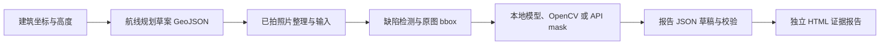

# 建筑外立面 MCP + LangChain 第一版

四个 MCP 服务与一条 LangGraph 工作流，把建筑坐标、航线草案、照片归档、缺陷检测、mask 与报告草稿连接起来。另提供 LangChain 模型自主调度入口。模型密钥不是 MCP 参数，未知检测、未知面积与未复核状态不会自动变成已确认结果。

## 当前可运行的流程



航线规划与拍照执行之间是现场采集环节。当前不会控制飞行器，也不会假装从坐标生成真实照片；没有照片时，模型模式应返回规划并指出待采集材料。规划使用建筑轮廓的轴对齐外包络，或坐标＋半径近似轮廓；高度相对起飞点尚待核验。GeoJSON 的 `executable=false`，不输出 DJI KMZ/WPML 或 MAVLink 指令。

检测支持真实标注导入、已有 FacadeFixer HTTP 接口，以及受控的本地模型。OpenCV 分割实际运行上游算法；API 分割需要服务端配置及明确选择。报告当前导出 JSON 与 HTML 草稿，未实现 DOCX/PDF、正式签署或归档。

## 已验证环境与安装

Python 3.12、FastMCP 4.1、LangChain 1.4、LangGraph 1.2；具体锁定版本见 `requirements.lock.txt`。`langchain.mcp.MCPAdapter` 当前为 beta，因此随项目锁定依赖。

先安装 Git、Python 3.12 和 `uv`，以下安装脚本使用 Windows PowerShell：

```powershell
git clone https://github.com/mo0407/FacadeFixer_mcp.git
cd FacadeFixer_mcp
.\setup.ps1
```

脚本创建项目自己的 `.venv`，安装依赖，并把两个上游仓库克隆到 `vendor/` 的已审阅版本。若已有仓库，可运行 `setup.ps1 -SkipUpstream` 后自行设置 `FACADE_MASK_REPO`。上游算法保持不变，集成服务不读取参考 mask。

开发时使用的上游版本：

| 仓库 | 版本 |
|---|---|
| FacadeFixer_mask_api | `6b5611f209aa6f0d82d530f35ab7ae264c7abf93` |
| FacadeFixer_report | `0c679ad29980a7bed7998058b68f946d27e2532b` |

复制 `.env.example` 为 `.env` 并填写路径；从项目目录启动时会读取它。API key 保存在环境变量中，不能写进工作流 JSON。MCP 配置导出不会包含进程密钥。

`setup.ps1` 安装本工程依赖并准备 Mask/Report 上游。Model MCP 需要另行准备 `FacadeFixer-main` 源码、它的独立模型环境与本地权重，再设置 `FACADE_SOURCE_REPO` 和 `FACADE_SOURCE_PYTHON`；这些内容不随本仓库发布。没有模型环境仍可连接 MCP，并运行标注导入、OpenCV 和报告流程。详细步骤见 [本地模型 MCP 接入说明](docs/LOCAL_MODEL_MCP.md)。

## 立即跑离线示例

```powershell
.\run_demo.ps1
# 或使用已有上游仓库
.\run_demo.ps1 -MaskRepo E:\ai\低空\.task_tmp\mask-mcp-feasibility
```

示例使用合成墙面照片和明确提供的演示检测框，经过实际 MCP 子进程、LangGraph、OpenCV 和报告渲染。它验证软件链路，不能用于评估真实识别准确率。每次运行创建新 job 目录，不覆盖旧报告。

本机另已用现有 YOLO12 权重在一张真实照片上完成检测与全流程，返回1条 RustStain 候选并生成实际 mask。查看 `outputs/first_version/report.html`。照片来自上游公开样本；建筑坐标是接口演示值，不代表照片定位。可用 `run_local_yolo_sample.ps1` 复现，或传入自己的 DetectorPython / Weights / MaskRepo。运行完成说明链路可用，不表示已核实识别准确性。

CLI 返回 `outputs.rendered.html.path`、报告 JSON、航线 GeoJSON 和 `trace.path`。打开 HTML 即可浏览原图、实例 mask、叠加图、真实像素面积、未补充项目资料与待复核状态。

## 换成自己的照片

编辑 `examples/workflow.example.json`：填写实际建筑坐标、高度和项目资料，设置 `image_paths`，选择检测方式。照片路径与 annotation_path 相对工作流文件所在目录解析；标注文件内的 image_path 相对标注文件所在目录解析。

```powershell
$env:FACADE_MASK_REPO='E:\path\FacadeFixer_mask_api'
.\.venv\Scripts\python.exe -m facade_mcp.cli --allow-root E:\photos run --config .\examples\workflow.example.json
```

工作流的每一步输入输出：

| 阶段 | 输入 | 输出 |
|---|---|---|
| 建筑信息 | WGS84 经度/纬度、高度、可选轮廓 | 已校验 site 与几何缺失提示 |
| 航线规划 | site、距离、拍摄高度、间距 | 不可执行的 GeoJSON、航点、待核验项 |
| 素材整理 | 已拍照片路径、可选拍摄元数据 | 内容哈希、去重归档、宽高、EXIF 提示 |
| 缺陷检测 | 照片与真实标注/检测配置 | 原图坐标 bbox、类别、置信度、未知类别 |
| mask | 原图、bbox、类别、分割方式 | 原尺寸实例/总/类别 mask、overlay、RLE、像素面积 |
| 报告草稿 | 项目数据、检测结果、mask 资产 | `facade-report/v1` 文档，未确认字段 |
| 校验与渲染 | 报告文档与证据 | 缺失列表、独立 HTML、证据资产 |

标注示例在 `examples/annotations.example.json`。所有 bbox 为 `[x1,y1,x2,y2]`，零起点、右下边界不包含。连续检测框在进入 mask 前按左上取 floor、右下取 ceil 转为整数；原始小数框仍保留。照片始终按存储像素处理；HTTP 上传为去除 EXIF 旋转影响的 PNG 像素副本。

### 检测方式

1. `annotations`：配置 `annotation_path`，只读取已提供框，未配置不会编造框。
2. `http`：设置 `FACADE_DETECTOR_URL=http://127.0.0.1:8000`、可选 `FACADE_DETECTOR_MODEL=yolo12m`，工作流改为 `"detection":{"method":"http","threshold":0.25}`。调用原项目 `/api/detect`，明确 `enable_doubao_justification=false`。返回后过滤阈值，不能恢复被后端先前滤掉的框。
3. `local_yolo`：设置 `FACADE_DETECTOR_PYTHON` 为已有 torch/ultralytics 环境、`FACADE_DETECTOR_WEIGHTS` 为已有权重、可选 `FACADE_DETECTOR_DEVICE=cpu`，工作流选择 `method=local_yolo`。模型在独立进程运行，不下载权重。

检测标签映射到 C/M/P/S/T/R/D/V/L，保留原类别名称。`Bulging` 等不支持的类别进入报告的待处理条目，没有替代 mask 或虚构面积。`Water_Stain` 是潮湿表征，映射 L 不表示已确认渗漏原因。

### API mask

设置 `FACADE_MASK_MODELS_CONFIG` 为上游兼容的模型配置文件，配置仅包含模型 ID、地址、transport、api_key_env 等服务端信息。密钥从相应环境变量读取。工作流配置：

```json
{"mask":{"method":"api","model_profile":"your_profile_id"},"allow_paid_api":true}
```

每个实例可能产生一次 API 请求；未知费用保持 null。任务通过 job_id 查询，不自动重试可能已提交但结果不明的付费请求。

## LangChain 模型自主模式

填写自己的支持 tool calling 的模型。可使用 OpenAI-compatible 本地或云端服务；不要把模型名称示例当作固定要求。

```powershell
$env:FACADE_LLM_MODEL='你的模型ID'
$env:FACADE_LLM_BASE_URL='你的兼容接口地址'
$env:FACADE_LLM_API_KEY='你的密钥'
.\.venv\Scripts\python.exe -m facade_mcp.cli --allow-root E:\photos agent --prompt '建筑编号B1，经度120.15纬度30.28，高度30米。请规划航线草案；照片为E:\photos\a.jpg，已有检测框文件E:\photos\annotations.json。使用OpenCV分割并生成报告草稿。'
```

该模式使用 `create_agent(ChatOpenAI, tools=...)`，工具从四个 MCP 服务实时发现。模型决定下一步工具与参数；结构化路径、哈希、坐标校验仍由代码执行。无照片/标注/检测配置时须明确停在缺失环节。消息与工具调用保存在 agent job 的 `messages.json`。此版本验证了脚本化离线模型的工具循环，未发送真实在线 LLM 请求。

`run` 模式使用固定 LangGraph 节点，适合回放与批处理；同样通过真实 MCP 调用各服务。状态依次为 site→route→media→detection→masks→report→validation→render，逐次调用记录于 `tool_calls.jsonl`。

## 直接连接 MCP

```powershell
.\.venv\Scripts\python.exe -m facade_mcp.cli --mask-repo E:\path\FacadeFixer_mask_api mcp-config --output .\mcp.local.json
```

输出四个 stdio 服务的配置，使用当前项目解释器和共享 artifact workspace。也可以本地 HTTP 启动：

```powershell
.\.venv\Scripts\python.exe -m facade_mcp.survey_server --transport http --port 8761
.\.venv\Scripts\python.exe -m facade_mcp.mask_server --transport http --port 8762
.\.venv\Scripts\python.exe -m facade_mcp.report_server --transport http --port 8763
.\.venv\Scripts\python.exe -m facade_mcp.model_server --transport http --port 8764
```

默认只监听本机；当前工具返回本机 artifact URI/路径，适合同机客户端。跨机器访问需要单独配置鉴权和可访问的资产资源服务。

## 工具表

| 服务 | 工具 |
|---|---|
| Survey | survey_validate_site、survey_plan_route、media_organize_images、defect_detect、survey_get_artifact |
| Mask | mask_validate_input、mask_segment_opencv、mask_start_api_job、mask_get_job、mask_refine、mask_get_artifact |
| Report | report_build_draft、report_validate、report_render_html、report_get_artifact |
| Model | facade_models_list、facade_models_detect、facade_models_segment、facade_models_refine、facade_models_get_job、facade_models_get_artifact |

输出 artifact 均包含 ID、URI、文件路径、SHA256、大小和角色。原图以哈希去重；每个阶段独立输出目录。mask RLE 保存在 JSON 产物中，不塞进模型上下文。缺失或失败绝不当作没有缺陷。

## 验证与边界

```powershell
$env:FACADE_MASK_REPO='E:\path\FacadeFixer_mask_api'
.\.venv\Scripts\python.exe -m pytest -q
```

测试覆盖真实 OpenCV、mask 尺寸/bbox/RLE/并集、图像哈希隔离、检测框归一化与小数转换、EXIF、未知类别、草稿证据状态、HTML、安全转义、四个 stdio MCP 的完整流程及 LangChain 工具循环。HTTP 检测单测只使用本地模拟服务，API mask 不调用。

参考标注或人工核实数据才能用于效果评价。运行时只输出结构检查与复核状态，不报告没有依据的准确率。报告 formal_ready 仅检查记录完整性和签署文件存在，不验证真实人员身份或密码学签名，也不代表工程鉴定已批准。

## 新增：FacadeFixer 本地模型统一管理

新增独立 Model MCP 服务，统一配置现有三个服务后共有 **4 个服务、21 个工具**。支持 YOLO11m/12m、RT-DETR、Faster R-CNN、合并/共识检测，以及 MobileSAM、SAM3、U-Net 裂缝 Mask；依赖与本机验证状态见 [本地模型 MCP 接入说明](docs/LOCAL_MODEL_MCP.md)。

```powershell
.\.venv\Scripts\python.exe -m facade_mcp.cli models
.\run_source_models.ps1
```

完整工作流配置为 `examples/source_models.workflow.json`，检测与 Mask 分别选择 `method: source` 和 `model_profile`。本机已验证真实 YOLO12m → MobileSAM → 报告；缺失依赖和未验证模型在文档中逐项列出。
## 代码入口

- `storage.py`：任务目录、哈希、资产注册与受限路径。
- `survey_service.py`：建筑坐标、路线草案与素材归档。
- `detection_service.py` / `yolo_worker.py`：标注/HTTP/本地YOLO检测适配。
- `mask_service.py`：复用上游分割与精修，输出统一 mask 契约。
- `report_service.py`：报告草稿适配、验证和独立 HTML 渲染。
- `*_server.py`：业务函数的 MCP 工具接口。
- `orchestration.py`：LangGraph 工作流与 LangChain create_agent。
- `cli.py`：启动、示例、配置生成。
