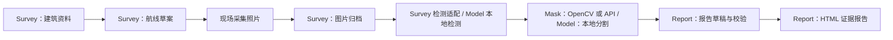
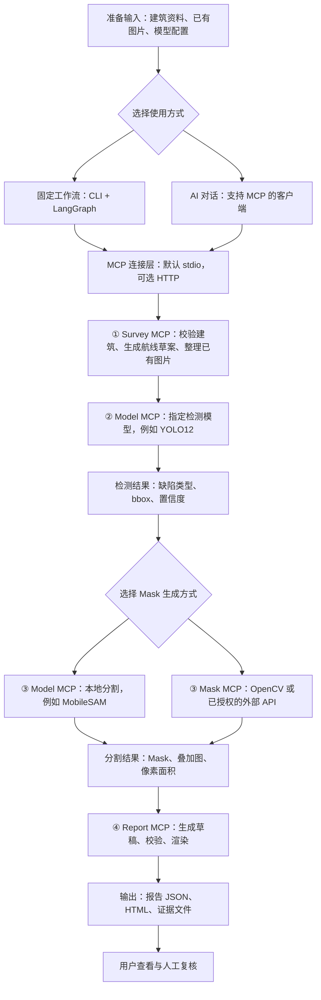
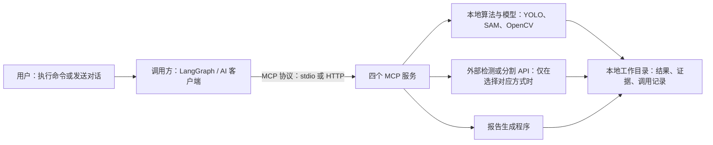

# FacadeFixer MCP + LangChain

建筑外立面巡检工具集：将建筑资料、航线草案、图片归档、缺陷检测、Mask 生成和报告草稿封装成 **4 个 MCP 服务、21 个工具**，供 MCP 客户端或 LangChain/LangGraph 调用。



## 导航

- [快速开始](#快速开始)
- [服务总览](#服务总览)
- [MCP 使用流程](#mcp-使用流程)
- [公共数据约定](#公共数据约定)
- [Survey MCP](#survey-mcp)：建筑资料、航线草案、图片归档、已有检测接口。
- [Model MCP](#model-mcp)：本地检测模型、分割模型、正负点精修。
- [Mask MCP](#mask-mcp)：OpenCV、API Mask、已有 Mask 的 OpenCV 精修。
- [Report MCP](#report-mcp)：报告草稿、完整性校验、HTML 导出。
- [编排与调用示例](#编排与调用示例)
- [验证与代码入口](#验证与代码入口)

## 快速开始

已验证环境：Python 3.12、FastMCP 4.1、LangChain 1.4、LangGraph 1.2。安装依赖以 `requirements.lock.txt` 为准；`langchain.mcp.MCPAdapter` 当前为 beta。

准备 Git、Python 3.12 和 `uv`，以下命令使用 Windows PowerShell：

```powershell
git clone https://github.com/mo0407/FacadeFixer_mcp.git
cd FacadeFixer_mcp
.\setup.ps1
Copy-Item .env.example .env
```

编辑 `.env` 中的本地路径，然后运行不产生付费 API 请求的示例：

```powershell
.\run_demo.ps1
# 使用已有 Mask 上游代码时：
.\run_demo.ps1 -MaskRepo E:\repos\FacadeFixer_mask_api
```

示例使用合成墙面照片、明确给定的检测框、真实 OpenCV 分割和报告渲染。CLI 返回报告 HTML、报告 JSON、航线 GeoJSON 和工具调用记录的资产路径。运行结果写入本机 `workspace/`，不随 Git 仓库分发。

安装脚本准备本工程环境，并克隆以下已核对版本：

| 上游仓库 | 使用方式 | 固定版本 |
|---|---|---|
| [FacadeFixer_mask_api](https://github.com/mo0407/FacadeFixer_mask_api) | OpenCV 分割、API 适配和 Mask 精修脚本 | `6b5611f209aa6f0d82d530f35ab7ae264c7abf93` |
| [FacadeFixer_report](https://github.com/mo0407/FacadeFixer_report) | 参考其证据与复核概念，当前实现为本工程的草稿桥接层 | `0c679ad29980a7bed7998058b68f946d27e2532b` |

Model MCP 还需要另行准备 `FacadeFixer-main` 源码、模型运行环境及本地权重，见 [Model MCP](#model-mcp)。只使用建筑资料、标注导入、OpenCV 和报告工具时，无需加载这些模型。

## 服务总览

| 服务 | 工具数 | 主要输入 → 输出 | Python 模块 | HTTP 默认端口 |
|---|---:|---|---|---:|
| Survey | 5 | 建筑资料/照片 → 航线草案、素材清单、检测框 | `facade_mcp.survey_server` | 8761 |
| Model | 6 | 照片/检测框/点提示 → 本地模型检测结果、Mask、新版本 | `facade_mcp.model_server` | 8764 |
| Mask | 6 | 原图 + bbox + 类别/已有 Mask → 分割与精修结果 | `facade_mcp.mask_server` | 8762 |
| Report | 4 | 项目资料 + 检测/分割结果 → 报告 JSON、检查结果、HTML | `facade_mcp.report_server` | 8763 |

**如何选择：**

- 已有标注、已有 `/api/detect` 后端，或只需单个已配置 YOLO：使用 Survey 的 `defect_detect`。
- 要在本地模型目录中选择 YOLO11/12、RT-DETR、SAM 或 U-Net：使用 Model。
- 要使用上游 OpenCV 算法、已授权的图像 API，或对已有 Mask 做 OpenCV 精修：使用 Mask。
- 要汇总证据、检查资料完整性并生成可浏览报告：使用 Report。

四个服务默认使用 **stdio**，可以单独运行，也可通过同一配置统一连接：

```powershell
.\.venv\Scripts\python.exe -m facade_mcp.cli mcp-config --output .\mcp.local.json
```

将生成的 `mcp.local.json` 导入客户端。该文件包含当前机器的解释器和路径，已加入 `.gitignore`。也可单独启动本机 HTTP 服务：

```powershell
.\.venv\Scripts\python.exe -m facade_mcp.survey_server --transport http --port 8761
.\.venv\Scripts\python.exe -m facade_mcp.model_server --transport http --port 8764
.\.venv\Scripts\python.exe -m facade_mcp.mask_server --transport http --port 8762
.\.venv\Scripts\python.exe -m facade_mcp.report_server --transport http --port 8763
```

HTTP 使用 MCP 协议，各工具通过 MCP `tools/call` 调用。下文 JSON 是工具的 `arguments` 示例。默认监听 `127.0.0.1`；跨机器部署还需配置鉴权与可访问的资产资源服务。

## MCP 使用流程

### 从图片到报告

下面以本地检测模型为例。固定工作流按节点顺序执行；AI 对话模式由客户端中的语言模型选择工具，也可以只执行检测或分割等单一步骤。



现场图片采集由用户完成，航线草案不会自动驱动无人机。上图展示已有图片的处理过程；固定工作流不会等待现场采集。模型检测也可以通过 Survey 的已有标注、HTTP 或 local_yolo 适配方式替换。

模型选择由工作流配置传入，例如下面的配置片段表示 YOLO12 输出类别和框，MobileSAM 生成 Mask：

```json
{
  "detection": {"method": "source", "model_profile": "yolo12m", "threshold": 0.25},
  "mask": {"method": "source", "model_profile": "mobile_sam"}
}
```

将上述字段写入包含建筑资料和图片路径的完整配置后运行，完整示例见 [source_models.workflow.json](examples/source_models.workflow.json)。当前固定工作流一次使用一个分割 profile，不会按缺陷类别自动切换模型；`unet_crack` 仅接受裂缝 C、网裂 M，其他类别会报错。

### 客户端、MCP 与模型如何连接



HTTP 默认端口是程序连接 MCP 的接口端口，**不是上传图片、选择模型的网页页面**。仅在 HTTP 模式启动时监听，默认绑定本机 `127.0.0.1`。使用 CLI 固定工作流时，程序通过 stdio 自动启动并连接服务，无需手动开放 8761～8764 端口。

MCP 的通信方式与模型运行位置是两个独立配置：本机 HTTP MCP 仍可运行本地模型，stdio MCP 也可调用已配置的外部 API。AI 对话模式还可能由客户端连接远程语言模型；本地 source 模型固定工作流不需要语言模型 API Key。

## 公共数据约定

### 配置与文件访问

| 环境变量 | 含义 | 默认/说明 |
|---|---|---|
| `FACADE_CONFIG_FILE` | 加载环境变量的文件 | 当前工作目录的 `.env`；已有环境变量优先 |
| `FACADE_WORKSPACE` | 任务、产物和资产注册目录 | `./workspace` |
| `FACADE_ALLOWED_INPUT_ROOTS` | 允许读取的输入根目录 | 未配置时为当前目录；多个目录用分号分隔 |

输入文件使用允许目录中的路径，或已注册资产的 `artifact:<id>` URI。消费资产 URI 时会校验内容哈希。CLI 还可使用 `--allow-root E:\inspection` 添加输入目录。

建议将密钥保存在环境变量中。导出的 MCP 配置会过滤进程密钥；客户端仍需通过服务端 `.env` 或环境变量提供检测/API/LLM 所需凭据。

### 图像、bbox、类别和 Mask

所有图像坐标采用**原图存储像素**：左上角零起点，bbox 为 `[x1,y1,x2,y2]`，右下边界不包含。检测得到的小数框以 `floor(x1/y1)`、`ceil(x2/y2)` 包围取整，同时保留原始小数框。EXIF 方向保留但不自动旋转栅格；HTTP 检测上传原存储像素重新编码的 PNG，保持检测与分割坐标一致。

Mask 工具接收的单个缺陷：

```json
{
  "instance_id": "D-01",
  "class_code": "C",
  "bbox_xyxy": [120, 65, 245, 395]
}
```

`instance_id` 在同一图片中唯一；bbox 必须为图内整数。可选 `class_name`；D 类可提供 `class_subtype: "WallStain"` 或 `"GroundLitter"`。

| 类别码 | 含义 | 类别码 | 含义 | 类别码 | 含义 |
|---|---|---|---|---|---|
| C | 线状裂缝 | M | 网裂 | P | 剥离 |
| S | 剥落 | T | 锈渍 | R | 锈蚀 |
| D | 污染物 | V | 植被 | L | 渗漏/潮湿表征 |

检测的原始名称仍被保留。`Bulging` 等未映射类别进入 `unmapped_defects` 并保留到报告待处理条目；不会生成替代 Mask 或虚构面积。`Water_Stain` 映射 L 只表示潮湿表征，渗漏原因仍需复核。

### 资产与状态

生成资产通常携带 `artifact_id`、`uri`、`path`、`sha256`、`size_bytes`、`role` 和 `media_type`。使用真实返回的 URI/路径连接下一步；不要根据文件名猜测产物位置。

| 数据 | 版本/主要内容 |
|---|---|
| 航线 | `schema_version: facade-route/v1`，GeoJSON 与规划参数 |
| 素材 | `schema_version: facade-media/v1`，图片标识、哈希、尺寸、归档路径 |
| 检测 | `schema: bbox_class_only_v1`，`images[].defects` 与 `unmapped_defects` |
| Mask | `schema_version: facade-mask/v1`，实例、并集、类别 Mask、叠加图、面积和溯源 |
| 批量 Mask | 工作流中的 `facade-mask-batch/v1`，`images[]` 包含单图结果 |
| 报告 | `schema_version: facade-report/v1`，项目、影像、缺陷与证据 |

任务记录的状态为 `running/completed/failed`；工具结果还可能包含 `planning_draft`、`submitted`、`candidate_requires_review`、`no_defects_provided` 等业务状态。任务完成表示程序执行完成，候选缺陷和 Mask 仍需复核。

Mask 完整清单保存 F order RLE、实际前景像素面积和质量标记，MCP 响应会移除大体量 RLE。没有标定时物理面积为 `null`。置信度、模型候选分数和程序运行成功均不代表已知准确率。

## Survey MCP

**定位：** 巡检前置资料与图片入口，负责建筑信息校验、航线草案、素材归档，并适配已有检测方式。入口文件：[survey_server.py](src/facade_mcp/survey_server.py)。

### 工具与输入输出

| 工具 | 输入参数 | 返回内容 |
|---|---|---|
| `survey_validate_site` | 必填 `site: object` | `valid`、规范化 `site`、`coordinate_system`、`warnings`；无效资料返回工具错误 |
| `survey_plan_route` | 必填 `site`；可选 `options: object` | `job_id`、规划参数、`waypoint_count`、估算长度/运动时间、核验项、`route` GeoJSON 和 `manifest` 资产 |
| `media_organize_images` | 必填 `image_paths: string[]`、`building_id: string`；可选 `capture_metadata: object` | `images[]`、图片资产、`duplicate_count` 和素材 `manifest` |
| `defect_detect` | 必填 `image_paths`；`method="annotations"`、`annotation_path=null`、`threshold=0.25` | 每图检测框、类别、置信度、未知类别、原图哈希、来源与检测清单资产 |
| `survey_get_artifact` | 必填 `artifact_id: string`，可带 `artifact:` 前缀 | 已注册资产的完整元数据 |

#### 建筑信息与规划参数

`site` 必填字段：`building_id`、`longitude`、`latitude`、`building_height_m`。可选 `name`、`building_radius_m`（默认 12）和 `footprint_lonlat`（至少三个 `[经度,纬度]` 顶点）；不接受其他 site 字段。

当前输入范围：经度 `[-180,180]`、纬度 `[-85,85]`、建筑高度 `(0,300]` 米、建筑半径 `(0,500]` 米。轮廓应在建筑坐标 2 km 内；未提供轮廓时使用建筑半径近似外包络，提供轮廓时使用其轴对齐外包络。

| `options` 字段 | 默认值 | 含义 |
|---|---|---|
| `stand_off_m` | 10 | 外包络外的规划距离，范围 3–200 m |
| `waypoint_spacing_m` | 8 | 水平航点间距，范围 1–100 m |
| `capture_heights_m` | 自动生成 | 指定拍摄高度数组，必须为正且不超过建筑高度 |
| `vertical_spacing_m` | 8 | 未指定高度数组时的层间距，范围 1–100 m |
| `speed_m_s` | 2 | 用于估算运动时间的速度，范围 `(0,10]` m/s |

调用 `survey_plan_route`：

```json
{
  "site": {
    "building_id": "B-001",
    "name": "巡检示例建筑",
    "longitude": 120.15,
    "latitude": 30.28,
    "building_height_m": 30,
    "building_radius_m": 12
  },
  "options": {
    "stand_off_m": 10,
    "capture_heights_m": [5, 15, 25],
    "waypoint_spacing_m": 8,
    "speed_m_s": 2
  }
}
```

服务响应提供航点数量，完整航点见 `manifest` 或 `route` 资产。航线始终为 `planning_draft`、`executable=false`；相对起飞点高度待核验。它不控制飞行器，也不输出 DJI KMZ/WPML 或 MAVLink 指令；障碍物、空域、天气、相机覆盖与返航条件由现场核验。

#### 素材归档

`media_organize_images` 读取已提供图片，计算 SHA-256，在本次调用内按内容去重，并复制到独立任务目录。每图保留 `image_id`、宽高、建筑编号、原路径、归档路径、EXIF 时间/方向及调用方补充元数据。

```json
{
  "image_paths": ["E:/inspection/photos/facade-001.jpg"],
  "building_id": "B-001",
  "capture_metadata": {
    "facade-001.jpg": {"facade_id": "south", "inspection_period": "本期"}
  }
}
```

`capture_metadata` 按原文件名关联，目前作为补充信息保存。此入口处理图片，不执行视频抽帧、自动 GPS/立面匹配或 3D 重建。单张图片上限为一亿像素。

素材中的 `capture_metadata.facade_id` 不会自动写入后续报告。需要展示立面信息时，上层应用应将 `facade_id` 传入分割实例，或传入按 `image_id + instance_id` 关联的检测项。

#### 三种检测入口

| `method` | 必需资料/配置 | 行为 |
|---|---|---|
| `annotations` | `annotation_path` | 导入明确提供的标注。缺失标注报错；显式空缺陷列表可以导入 |
| `http` | `FACADE_DETECTOR_URL`；可选 `FACADE_DETECTOR_MODEL`、`FACADE_DETECTOR_TOKEN` | 调用后端 `/api/detect`，设置 `enable_doubao_justification=false` |
| `local_yolo` | `FACADE_DETECTOR_PYTHON`、`FACADE_DETECTOR_WEIGHTS` | 使用已有环境和权重，通过独立进程运行单个 YOLO |

可选 `FACADE_DETECTOR_DEVICE` 默认 `cpu`，`FACADE_DETECTOR_TIMEOUT_SECONDS` 默认 180 秒。`threshold` 范围 `[0,1]`：本地 YOLO 在推理时应用；HTTP 入口在返回后过滤，不能恢复被后端提前过滤的框。

调用 `defect_detect` 导入标注：

```json
{
  "image_paths": ["E:/inspection/photos/facade-001.jpg"],
  "method": "annotations",
  "annotation_path": "E:/inspection/annotations.json",
  "threshold": 0.25
}
```

标注结构见 [annotations.example.json](examples/annotations.example.json)。原图与标注需准确关联，尺寸、哈希和坐标会被检查。选择 Model MCP 的多模型能力时调用 `facade_models_detect`；`defect_detect` 的 `method` 不接收 `source`。

## Model MCP

**定位：** 统一管理 `FacadeFixer-main` 中的本地检测和分割能力，在独立 Python 子进程中执行。入口文件：[model_server.py](src/facade_mcp/model_server.py)，详细实现说明见 [LOCAL_MODEL_MCP.md](docs/LOCAL_MODEL_MCP.md)。

### 环境配置

| 环境变量 | 含义 | 默认/说明 |
|---|---|---|
| `FACADE_SOURCE_REPO` | `FacadeFixer-main` 源码目录 | 当前开发目录结构下可发现相邻 `项目代码/FacadeFixer-main`；部署时建议显式配置 |
| `FACADE_SOURCE_PYTHON` | 已有 Torch/模型依赖的 Python | 默认源目录 `.venv` 的解释器，与 MCP 环境分开 |
| `FACADE_SOURCE_DEVICE` | 推理设备 | `cpu`；也支持 `cuda`、`cuda:N`、数字 GPU 索引 |
| `FACADE_SOURCE_TIMEOUT_SECONDS` | 单个模型进程/等待运行槽位的超时 | 默认 600 秒，范围 1–7200 秒 |

源码与模型权重不随本仓库发布，服务不自动下载权重或安装模型依赖。子进程不继承 API 密钥，阻断联网，配置与缓存写入任务目录。每个服务实例同时运行一个模型子进程；启动多个服务实例会各自占用资源。

### 工具与输入输出

| 工具 | 输入参数 | 返回内容 |
|---|---|---|
| `facade_models_list` | 无参数 `{}` | 模型目录、运行环境、依赖/权重缺失、`availability` 与探测任务 ID |
| `facade_models_detect` | 必填 `image_paths`，1–100 张；`model_profile="yolo12m"`、`threshold=0.25` | `bbox_class_only_v1` 检测结果、原图快照、模型/权重/代码溯源、清单资产 |
| `facade_models_segment` | 必填 `image_path`、`defects`；`model_profile="mobile_sam"` | `facade-mask/v1` 清单、原始/选用 Mask、叠加图、像素面积及质量标记 |
| `facade_models_refine` | 必填 `image_path`、`annotation_manifest_path`、`instance_id`、`positive_points`、`negative_points`；`model_profile="mobile_sam"` | 同一实例的新 Mask 版本，父版本/父资产、点提示事件及哈希；其他实例保留 |
| `facade_models_get_job` | 必填 `job_id` | 持久化的任务状态，及 `result` 或 `error` |
| `facade_models_get_artifact` | 必填 `artifact_id`，可带 `artifact:` 前缀 | 已注册资产的完整元数据 |

目录中的 `available_unverified` 只表示依赖和权重文件存在，仍需实际调用验证。探测不会加载模型执行推理。`detect/segment/refine` 同步返回，`get_job` 可在事后查询结果；客户端应给长任务设置足够的超时。

### 九个模型 profile

| profile | 能力 | 说明 |
|---|---|---|
| `yolo12m` | 检测 | 本地 YOLO12m 建筑缺陷权重 |
| `yolo11m` | 检测 | 本地 YOLO11m 建筑缺陷权重 |
| `rtdetr` | 检测 | 本地 RT-DETR 权重 |
| `faster_rcnn` | 检测 | 固定 Detectron2 配置，需要该环境中已有 `detectron2` |
| `ensemble` | 合并检测 | 固定运行 YOLO12m、YOLO11m、RT-DETR，全部成功后合并 |
| `intersection` | 共识检测 | 同上，候选需至少两个不同模型支持 |
| `mobile_sam` | bbox/点提示分割 | 本地 MobileSAM，分割上述九类已给定的缺陷框 |
| `sam3` | bbox/点提示分割 | 本地 Ultralytics SAM3 路径，加载前需考虑内存/显存 |
| `unet_crack` | 裂缝分割 | 仅 C/M 类，使用源 UNet16 架构和预处理，二值阈值 0.2 |

合并/共识使用本工程明示的三模型成员和投票规则，与旧后端流程存在适配差异，细节保存在 provenance 中。通用 COCO `yolo11n-seg.pt` 没有注册为建筑缺陷模型。

调用 `facade_models_detect`：

```json
{
  "image_paths": ["E:/inspection/photos/facade-001.jpg"],
  "model_profile": "yolo12m",
  "threshold": 0.25
}
```

将返回的原图路径/URI 和 `images[].defects` 传给 `facade_models_segment`：

```json
{
  "image_path": "E:/inspection/photos/facade-001.jpg",
  "model_profile": "mobile_sam",
  "defects": [{"instance_id": "D-01", "class_code": "C", "bbox_xyxy": [120, 65, 245, 395]}]
}
```

以上 bbox 仅示范输入格式；实际分割应传检测或人工标注返回的框。实例 Mask 保持原尺寸并限制在 bbox 内，同时保留 `raw_model_mask` 和 `bbox_clipped_pixels` 供复核。

### 正负点精修

`facade_models_refine` 的 `annotation_manifest_path` 使用上一版返回的 `annotation_manifest.uri` 或 `annotation_manifest_path`。`instance_id` 也取自上一版；两组点都是原图像素 `[x,y]` 数组，可以有一组为空，但总计至少一个点。

```json
{
  "image_path": "E:/inspection/photos/facade-001.jpg",
  "annotation_manifest_path": "artifact:<上一版返回的清单ID>",
  "instance_id": "D-01",
  "positive_points": [[170, 180], [175, 230]],
  "negative_points": [[130, 100]],
  "model_profile": "mobile_sam"
}
```

请将占位 URI 替换为真实返回值。精修检查原图哈希、父 Mask 哈希和尺寸，保持旧版不变；新版记录 `revision`、父清单、事件和 `events_sha256`。当前语义是在同一 bbox 内结合正负点重新预测，上一版 Mask 不作为模型 logits 输入。支持 `mobile_sam/sam3`；U-Net 不接受点提示。

开发验证已跑通 YOLO11m、YOLO12m、RT-DETR、MobileSAM、U-Net 和 MobileSAM 点精修。Faster R-CNN 在开发机因缺少 `detectron2` 明确失败；SAM3 因当时可用内存较少跳过大权重加载验证。实际可用性以部署机器的调用结果为准。

## Mask MCP

**定位：** 封装 [FacadeFixer_mask_api](https://github.com/mo0407/FacadeFixer_mask_api) 的分割与后处理能力，输出统一 Mask 契约。入口文件：[mask_server.py](src/facade_mcp/mask_server.py)。

### 环境配置

| 环境变量 | 含义 |
|---|---|
| `FACADE_MASK_REPO` | 上游代码目录，安装脚本默认准备 `./vendor/FacadeFixer_mask_api` |
| `FACADE_MASK_MODELS_CONFIG` | 可选：服务端的 API 模型 profile JSON 文件 |
| profile 中 `api_key_env` 指向的变量 | 仅 API 路径需要的真实密钥 |

OpenCV 路径调用上游 `skills/facade-opencv-mask/scripts/segment.py`，不需要图像 API 密钥。API 路径调用上游 `scripts/api_adapter.py`；精修调用 `scripts/refine_api_masks.py`。

### 工具与输入输出

| 工具 | 输入参数 | 返回内容 |
|---|---|---|
| `mask_validate_input` | 必填 `image_path`、`defects` | `valid`、`errors`、规范化缺陷、尺寸/原图哈希、坐标约定、质量标记和 `estimated_api_requests`；不执行分割 |
| `mask_segment_opencv` | 必填 `image_path`、`defects` | 同步生成 `facade-mask/v1`、实例/并集/类别 Mask、裁剪图、叠加图、像素面积、清单资产 |
| `mask_start_api_job` | 必填 `image_path`、`defects`、`model_profile` | 立即返回 `status="submitted"`、`job_id`、`estimated_api_requests` |
| `mask_get_job` | 必填 `job_id` | 任务记录；成功时 `result` 包含分割结果的压缩响应，失败时包含安全错误摘要 |
| `mask_refine` | 必填 `image_path`、`annotation_manifest_path` | 对上一版所有实例进行 OpenCV 精修，新任务保留原始、候选和选用 Mask 资产 |
| `mask_get_artifact` | 必填 `annotation_manifest_path`，支持路径或资产 URI | 读取已有 `facade-mask/v1` 清单内容；大体量 RLE 仍在文件中 |

注意 `mask_get_artifact` 接收的是 **Mask 清单引用**，返回清单内容；其他服务中的 `*_get_artifact(artifact_id)` 通常用于读取资产元数据。

调用 `mask_validate_input` 或 `mask_segment_opencv` 的 arguments：

```json
{
  "image_path": "E:/inspection/photos/facade-001.jpg",
  "defects": [{"instance_id": "D-01", "class_code": "C", "bbox_xyxy": [120, 65, 245, 395]}]
}
```

输入以原图 + 固定 bbox + 类别为依据；`mask/polygon/contour/prior_mask` 等几何先验不属于自动分割参数。空实例列表会产生 `no_defects_provided`；实例分割为空时仍保留该实例及质量标记。MCP 响应主要使用 `instances[]`，完整清单还包含 RLE 等字段。

### API 分割与异步任务

API 模型通过服务端命名 profile 管理，profile 包含 `id`、`model`、HTTPS `base_url`、`api_key_env`，可选 `transport`（`multipart/json/dashscope`）等上游适配参数。禁止在该配置中内联 `api_key`、`key_file` 或认证 `headers`；调用方只能传 profile ID。

用户已授权 API 生成、服务端已配置对应 profile 时，调用 `mask_start_api_job`：

```json
{
  "image_path": "E:/inspection/photos/facade-001.jpg",
  "defects": [{"instance_id": "D-01", "class_code": "C", "bbox_xyxy": [120, 65, 245, 395]}],
  "model_profile": "your_profile_id"
}
```

随后将真实返回的 `job_id` 传给 `mask_get_job`：

1. `running`：任务执行中，稍后继续查询。
2. `completed`：读取 `result.annotation_manifest`、`result.instances` 等结果。
3. `failed`：读取 `error`，由调用方决定后续处理。

调用 `mask_start_api_job` 会提交请求，可能按实例计费。直接 MCP 调用没有 `allow_paid_api` 参数，客户端须先取得授权；LangGraph 的 API 分支另要求工作流设置 `allow_paid_api=true`。不自动重试已提交但结果不明的请求；费用未知时保留 `null`。任务状态落盘，但进程重启不会自动续跑中断的后台任务。

### OpenCV 精修

`mask_refine` 读取已有清单和对应的原始图片，校验图像/Mask 哈希，再生成新任务的 `raw_mask`、`candidate_mask` 和选用 `mask`。旧版不覆盖，记录来源清单哈希、算法哈希和来源任务。

这一路径使用已有候选 Mask 做 OpenCV 后处理，不接收正负点或画笔参数。需要 SAM 正负点交互时使用 `facade_models_refine`。两种精修都保留 `expert_validated=false`。

## Report MCP

**定位：** 将检测与分割结果整理为可追溯的报告草稿，检查资料和证据完整性，生成可直接打开的 HTML。入口文件：[report_server.py](src/facade_mcp/report_server.py)。

当前实现借鉴上游 [FacadeFixer_report](https://github.com/mo0407/FacadeFixer_report) 的证据与复核概念，输出本工程的 `facade-report/v1`。草稿构建和 HTML 渲染由本工程执行，尚未接入上游冻结版 `ReportDocument` 或正式模板导出。

### 配置与输入组织

使用公共 workspace 与输入目录配置。可选 `FACADE_REPORT_REPO` 记录上游仓库来源；当前草稿生成不要求加载上游报告引擎，也不调用 LLM。

`project` 建议包含：

```json
{
  "project_id": "inspection-001",
  "building_id": "B-001",
  "name": "B-001 外立面巡检",
  "period": "本期",
  "inspection_date": "2026-10-19",
  "responsible_party": "待填写"
}
```

`segmentation_result` 直接传 Mask/Model 分割工具返回的对象；多图使用 `{"images":[单图结果, ...]}`。可选 `detection_result` 传检测工具的完整返回值。关联依赖 `image_id + instance_id`，不依赖数组顺序。

### 工具与输入输出

| 工具 | 输入参数 | 返回内容 |
|---|---|---|
| `report_build_draft` | 必填 `project`、`segmentation_result`；可选 `detection_result` | 报告 JSON 的 `report_document`/`artifact`、`defect_count`、`unsegmented_defect_count` 和初步 `validation` |
| `report_validate` | 必填 `document_path`，支持允许目录路径、资产 URI 或裸资产 ID | `schema_valid`、`draft_ready`、`formal_ready`、`errors`、`missing_fields` |
| `report_render_html` | 必填 `document_path`，取上一工具的 `report_document.uri` | 新渲染任务的 `html`/`artifact`、证据 `assets[]`、`validation`、`format="standalone_html"`、`draft=true` |
| `report_get_artifact` | 必填 `artifact_id`；也支持可解析的 URI/路径 | `path`、`sha256`、`size_bytes` |

构建草稿后，下一步按返回值连接：

```python
# 参数对象均来自前面真实工具返回；这里说明数据连接方式。
build_arguments = {
    "project": project,
    "segmentation_result": segmentation_result,
    "detection_result": detection_result,
}
validate_arguments = {"document_path": draft_result["report_document"]["uri"]}
render_arguments = {"document_path": draft_result["report_document"]["uri"]}
```

报告会关联原图、局部图、Mask、叠加图和位置图等已提供证据，保留原始输入与方法记录。未分割类别仍有待处理条目；像素面积从分割结果的 `area_pixels` 传入，不以 bbox 面积代替。

计算标定后估算面积时，提供 `scale: {"meters_per_pixel": 0.001, "source": "现场标尺标定"}`。标定按 `实例.scale → 单图结果.scale → project.scale` 依次取值；比例必须为正数，且有明确来源。计算为 `area_pixels × meters_per_pixel²`，仍为估算值。

### 校验、编辑和导出边界

- `schema_valid` 表示报告结构通过检查；`draft_ready` 表示该结构可以作为草稿使用。缺少日期、立面、面积或复核资料等会列入 `missing_fields`。
- 新建报告始终为待复核草稿，既有专家结论也会保留为来源资料并重新进入待确认状态。
- `formal_ready` 检查资料、复核记录和签署文件是否齐备，不认证人员身份、签名真伪或工程结论正确性。
- HTML 内嵌证据图片，非图片证据需同时保留 `assets/` 附件。当前导出 JSON 与 HTML，尚无 DOCX/PDF、正式签署和归档工具。
- 当前 Report MCP 没有在线编辑、修改记录或训练数据回流工具。需要修改时，由上层应用生成新报告 JSON 并保留自己的版本记录，再调用校验与渲染；不要改写已注册资产文件，否则哈希校验会失败。

## 编排与调用示例

### 固定流程：LangGraph

编辑 [workflow.example.json](examples/workflow.example.json)，填写建筑坐标、高度、项目资料和自己的图片路径，然后执行：

```powershell
.\.venv\Scripts\python.exe -m facade_mcp.cli --allow-root E:\inspection run --config .\examples\workflow.example.json
```

CLI 配置中的照片路径、`annotation_path` 相对工作流文件所在目录解析。直接 MCP 调用中的相对路径则相对服务进程工作目录解析，部署时建议使用绝对路径或资产 URI。

| 工作流配置 | 实际 MCP 工具 |
|---|---|
| `detection.method=annotations/http/local_yolo` | `defect_detect` |
| `detection.method=source` | `facade_models_detect`，使用 `detection.model_profile` |
| `mask.method=opencv` | `mask_segment_opencv` |
| `mask.method=source` | `facade_models_segment`，使用 `mask.model_profile` |
| `mask.method=api` | `mask_start_api_job` + `mask_get_job`，并要求 `allow_paid_api=true` |

本地模型示例配置：

```json
{
  "detection": {"method": "source", "model_profile": "yolo12m", "threshold": 0.25},
  "mask": {"method": "source", "model_profile": "mobile_sam"}
}
```

完整版本见 [source_models.workflow.json](examples/source_models.workflow.json)，准备好模型环境后可运行 `run_source_models.ps1`。也可混合使用 source 检测 + OpenCV 分割，或标注导入 + source 分割。

固定节点顺序为 `site → route → media → detection → masks → report → validation → render`，每一步通过真实 MCP 调用。结果中的 `trace.path` 指向 `tool_calls.jsonl`，记录工具、参数、结果、耗时与失败信息。

### 自主调度：LangChain Agent

Agent 从同一配置动态发现 21 个工具，由语言模型选择下一步工具和参数。只有此模式额外需要支持 tool calling 的 LLM：

```powershell
$env:FACADE_LLM_MODEL='你的模型ID'
$env:FACADE_LLM_BASE_URL='你的兼容接口地址'
$env:FACADE_LLM_API_KEY='你的密钥'
.\.venv\Scripts\python.exe -m facade_mcp.cli --allow-root E:\inspection agent --prompt '建筑编号B-001，经度120.15纬度30.28，高度30米。照片为E:\inspection\photos\facade-001.jpg。先查看本地模型，使用可用检测模型和MobileSAM生成Mask，再生成报告草稿。'
```

也可使用 `OPENAI_API_KEY` 提供兼容模型凭据。客户端必须处理工具错误和缺失资料，不能编造 bbox、模型能力或准确率。消息与调用记录保存在 Agent 任务的 `messages.json`。当前已验证离线脚本模型的工具循环，未执行真实在线 LLM 评测。

### 直接使用 MCP 客户端

先生成 `mcp.local.json`。下面示例只发现工具并校验建筑资料，不调用检测模型或付费 API；在项目环境中运行：

```python
import asyncio
import json
from pathlib import Path
from fastmcp import Client
from fastmcp.client.transports import MCPConfigTransport

async def main():
    config = json.loads(Path("mcp.local.json").read_text(encoding="utf-8"))
    transport = MCPConfigTransport(config, name_as_prefix=False)
    async with Client(transport) as client:
        tools = await client.list_tools()
        print([tool.name for tool in tools])
        result = await client.call_tool("survey_validate_site", {
            "site": {"building_id": "B-001", "longitude": 120.15,
                     "latitude": 30.28, "building_height_m": 30}
        })
        print(result.structured_content)

asyncio.run(main())
```

## 验证与代码入口

```powershell
$env:FACADE_MASK_REPO='E:\repos\FacadeFixer_mask_api'
.\.venv\Scripts\python.exe -m pytest -q
.\.venv\Scripts\python.exe -m facade_mcp.cli models
```

发布前完整测试为 **105 项通过**。测试覆盖真实 OpenCV、坐标/EXIF/RLE/并集、原图与资产哈希、未知类别保留、报告草稿、HTML、安全边界、四个 stdio MCP 的完整流程及 LangChain 工具循环。API Mask 测试不发送真实付费请求。

真实照片示例来自上游公开样本，坐标仅用于软件链路演示，不代表照片定位。历史验证产物未随仓库提交；运行后根据 CLI 返回的 `outputs.rendered.html.path` 打开当前报告。运行成功与模型效果评价是两类结果，有参考标注或人工核实数据后才能计算准确率等指标。

| 文件 | 职责 |
|---|---|
| [storage.py](src/facade_mcp/storage.py) | 任务、资产注册、哈希与路径限制 |
| [survey_service.py](src/facade_mcp/survey_service.py) | 建筑、航线草案、素材归档 |
| [detection_service.py](src/facade_mcp/detection_service.py) | 标注、HTTP 和单 YOLO 适配 |
| [model_service.py](src/facade_mcp/model_service.py) | 本地模型目录、任务执行和精修版本 |
| [source_detection_worker.py](src/facade_mcp/source_detection_worker.py) / [source_mask_worker.py](src/facade_mcp/source_mask_worker.py) | 源模型适配与推理 |
| [mask_service.py](src/facade_mcp/mask_service.py) | OpenCV、API Mask、Mask 后处理 |
| [report_service.py](src/facade_mcp/report_service.py) | 草稿构建、校验、HTML 渲染 |
| [orchestration.py](src/facade_mcp/orchestration.py) | LangGraph 固定流程、LangChain Agent |
| [cli.py](src/facade_mcp/cli.py) | 工作流、示例、配置和模型目录命令 |

补充说明：[本地模型接入](docs/LOCAL_MODEL_MCP.md) · [仓库内容与本地配置](docs/REPOSITORY_CONTENTS.md)
