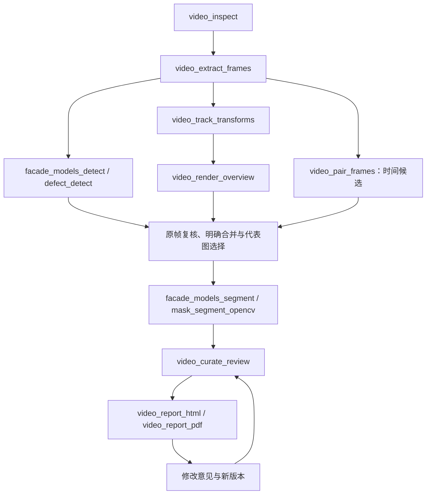

# Video MCP：视频巡检链路

本服务把视频变成可追溯的原帧证据、立面位置参考图和复核报告。已有 Model / Mask 服务继续负责检测与分割，不复制模型权重或特定建筑的人工标注。2026-10 的视频实验文件不打包进仓库。

## 服务分工

| 服务 | 负责什么 | 输入 → 输出 |
|---|---|---|
| Survey | 建筑与航线草案、图片归档 | 建筑资料／照片 → 计划与清单 |
| Video（新增） | 视频检查、抽帧、配对、总览、视频复核台账及导出 | 本地视频／明确证据 → 帧资产、总览、版本化台账、HTML／PDF |
| Model | 本地检测、分割与点提示精修 | 原图／bbox／提示 → 类型候选、bbox、Mask |
| Mask | OpenCV／配置好的 API 分割与精修 | 原图＋bbox＋类型 → Mask／叠加／RLE |
| Report | 原有结构化报告草稿、校验和 HTML | 标准检测／分割结果 → 原有格式报告 |

Video 的报告是本次视频分析的证据草稿，不替代 Report 的原有格式或审核条件。两个报告模型目前没有自动互转。现有 `facade-workflow run` 仍执行图片工作流；Agent 可从统一配置发现 Video 工具，视频链路也可以逐个 MCP 调用。没有宣称已经上线自动视频网页流程。



## 启动与统一管理

```powershell
python -m pip install -e ".[pdf]"   # PDF 为可选依赖；不需要 PDF 时用 -e .
$env:FACADE_WORKSPACE = "E:\inspection\workspace"
$env:FACADE_ALLOWED_INPUT_ROOTS = "E:\inspection\inputs;C:\Windows\Fonts"
python -m facade_mcp.video_server
# 可选 MCP HTTP 传输，不是网页：
python -m facade_mcp.video_server --transport http --port 8765
facade-workflow mcp-config --output mcp.local.json
```

配置生成器现在包含 survey / model / mask / report / video 五个服务。默认 stdio 不监听 HTTP 端口。字体只在导出 PDF 时需要，Windows 可传 `C:\Windows\Fonts\msyh.ttc`；其他系统提供允许读取的中文 TrueType 字体。

## 九个工具的输入、输出和边界

| 工具 | 主要输入 | 输出 | 说明 |
|---|---|---|---|
| `video_inspect` | `video_path`, `modality` | metadata、manifest | 分辨率／fps／帧数／时长／源哈希；GPS、辐射测温数据未检查，null 不代表不存在 |
| `video_extract_frames` | 视频、`sample_count` 或 `timestamps` | 原尺寸 PNG、精确解码帧号、相对时间、清晰度、manifest | 最多 200 帧，清晰度不是准确率；不自动宣布哪帧最好 |
| `video_pair_frames` | 可见光和热像帧 manifest、时间偏移及容差 | 一对一时间候选、未匹配帧 | 约定 `thermal_time = visible_time + offset`；按最近时间贪心配对，需要地标复核 |
| `video_track_transforms` | 视频、同源帧 manifest、stride、tracking_width | transforms、画布大小、跟踪检查 | 稠密 LK + 前后向检查 + RANSAC，输出平移基线；最多 18000 帧，弱纹理或大运动拒绝处理 |
| `video_render_overview` | 帧 manifest、transforms、画布、markers | 原总览、标注总览、坐标映射 | 支持调用方复核后的单应矩阵；默认不自动矫正透视、不补画；最多 24 MP |
| `video_curate_review` | project、defects、actor、reason、可选父版本及总览 | 版本化台账、定位图、局部图、Mask 叠加 | 明确提供合并与分组；同一 evidence_id 不能分属多个缺陷，不自动识别物理同一性 |
| `video_report_html` | review manifest | 单文件内嵌图片 HTML | 包含总览、逐缺陷定位图、局部图、Mask 和文字，文本转义 |
| `video_report_pdf` | review manifest、font_path | PDF、页数、待视觉审核标记 | 可选 reportlab；自动分页，长内容可能跨页；导出后仍需检查排版 |
| `video_get_artifact` | artifact_id | 本地资产元数据 | 与既有 ArtifactStore 统一管理 |

所有修改输出到新 job，输入源文件不被覆盖。返回 `status=failed` 时读取 `error`，不要继续使用该任务的半成品。使用返回的 `artifact:...` URI 可验证资产哈希；不要猜测文件路径。

### 1. 抽帧与配对

```json
{"video_path":"E:/inspection/inputs/visible.mp4","modality":"visible","sample_count":16}
```

对热像调用相同工具，改为 `modality=thermal`。用两次返回的 `manifest.uri` 配对：

```json
{"visible_manifest":"artifact:<visible-frames-id>","thermal_manifest":"artifact:<thermal-frames-id>","offset_seconds":0,"tolerance_seconds":0.25}
```

两段视频帧数相同不代表已经同步。没有相同地标时不能将时间配对当空间对应。

### 2. 总览与标注

调用 `video_track_transforms(video_path, frame_manifest)`，将返回的 `transforms`、`canvas_width`、`canvas_height` 原样传给 `video_render_overview`。

矩阵逐个对应 manifest 的 frames 顺序，映射 **原图像素 → 输出画布像素**。标记格式：

```json
[{"frame_id":"<returned-frame-id>","defect_id":"D01","bbox_xyxy":[100,200,250,350]}]
```

平移基线适用于运动较小、立面相对平坦的素材。瓷砖重复纹理、变焦、姿态变化和突出窗台可能造成误配、漂移和重影。输出始终 `needs_visual_review`。本次案例的人工透视引导、双模态地标对齐并未固化成通用自动算法；高级矩阵可由调用方提供，不得把案例坐标套在其他建筑上。

### 3. 检测和 Mask

`video_extract_frames` 返回 `frames[].image.uri`，可直接作为 `facade_models_detect.image_paths` 的元素。识别在原帧进行，总览只用于定位与查漏。用户选择模型仍通过 `model_profile`，提示方式沿用已有 `bbox / point / text / compare` 等支持范围。

复核后，把原帧及 bbox 交给已有分割服务。不存在可靠检测／分割条件时保留待处理，不用 bbox 填充代替真实 Mask。本服务不会把普通检测模型套在热像上，也不把颜色阈值当作温度或空鼓诊断。

### 4. 台账示例

参见 [`examples/video-review.example.json`](../examples/video-review.example.json)，这是 `video_curate_review` 的参数模板，路径需替换为真实返回资产。

关键规则：

- `defect_id` 表示明确分组后的一个位置；可见光和热像属于同一位置时放进同一 evidence 数组。
- `evidence_id` 唯一，每个缺陷最多 8 张代表证据。不要把所有重复帧都放进报告。
- bbox 是原图零基 `xyxy`，右下端点不含；Mask 必须原尺寸、单通道、0/255、非空并位于 bbox 内。
- Mask 需要 `mask_method` 和 `mask_semantics`。热像只接受 `pseudocolor_candidate`，不能声明为 `confirmed_void`。
- observation、interpretation、recommendation 分开：现象、推测和建议不能混成诊断。
- 没有温度矩阵时不计算温差；没有几何标定时不换算物理面积。
- `review_status=reviewed` 是调用方的复核记录，不是身份认证或专家签章。

修改时提交完整 project/defects 快照，并把上一版 `manifest.uri` 作为 `parent_manifest`，填写 actor 和 reason。新版本记录父文件哈希及时间；它是本地可追溯版本链，不是防篡改数据库、权限系统或自动训练流水线。用于训练前仍需审核与授权。

### 5. 导出

```json
{"review_manifest":"artifact:<review-id>"}
```

传给 `video_report_html`。PDF 则增加 `font_path`：

```json
{"review_manifest":"artifact:<review-id>","font_path":"C:/Windows/Fonts/msyh.ttc"}
```

总览通过 curate 的 `overviews=[{"label":"可见光总览","image_path":"artifact:..."},{"label":"热像总览","image_path":"artifact:..."}]` 传入。HTML 并排展示，不会凭空完成两图的空间配准。报告始终 `formal_ready=false`。

## 验证

```powershell
python -m pytest tests/test_video_service.py tests/test_model_workflow.py -q
```

测试使用合成运动视频验证帧号、位移与配对，验证 Mask 尺寸、语义限制、版本链、HTML 转义、资产篡改拒绝，并通过真实 stdio 子进程调用 Video MCP。不把测试通过解释为真实建筑缺陷识别精度。
